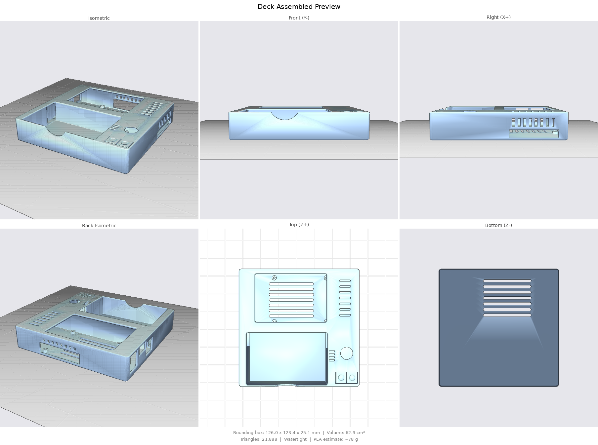
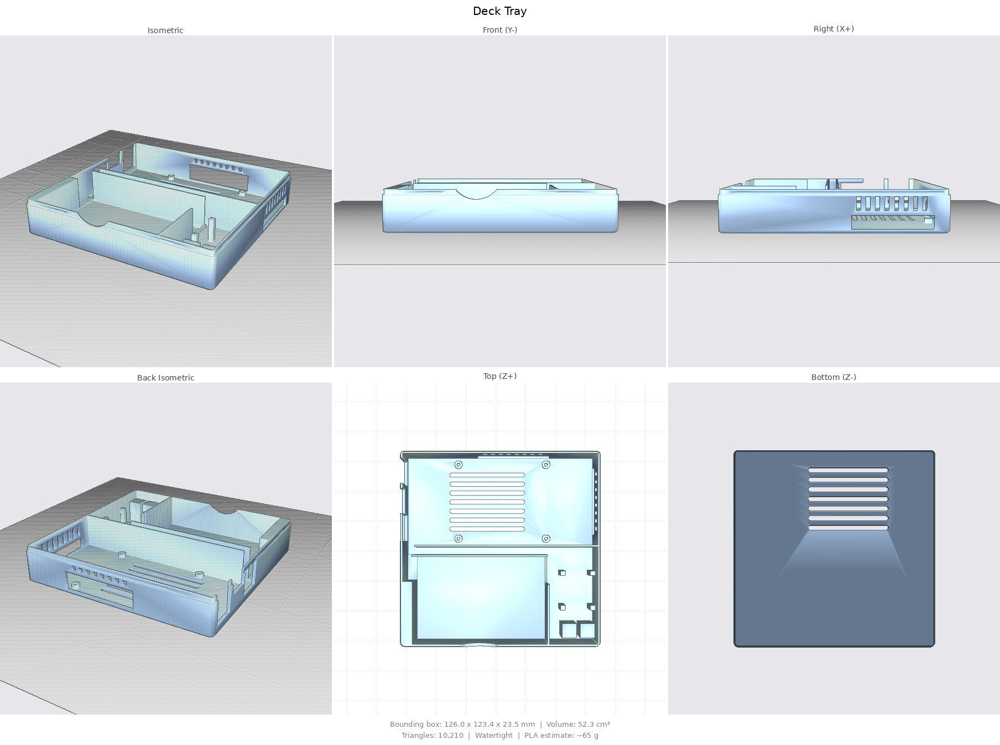

# Pi 5 + Cardputer Mini-Deck

A pocket Linux machine: **Raspberry Pi 5** with a **3.5" GPIO touchscreen** on top, and an
**M5Stack Cardputer** in front of it as the **keyboard** and a **second screen for status
and notifications**, plus a **trackball with L / R buttons** to the right of the keys.



```
             back:  USB-C power · micro-HDMI x2 · UART
   ┌─────────────────────────────────────────────┐
   │  ┌───────────────────────────────────────┐  │
   │  │     3.5" LCD  (Linux desktop/TTY)     │  │  right: microSD / power button
   │  │     Raspberry Pi 5 underneath         │  │
   │  └───────────────────────────────────────┘  │
   ├──────────────────[ cable tunnel ]───────────┤
   │  ┌───────────────────────────────────────┐  │
   │  │ [status screen]   M5Stack Cardputer   │  │
   │  │  q w e r t y u i o p  (keyboard)      │  │
   │  └───────────────( finger )──────────────┘  │
   └─────────────────────────────────────────────┘
   left: hidden cable channel; Ethernet + 3 USB-A   front
```

## 1. Parts

| Qty | Part | Notes |
|---|---|---|
| 1 | Raspberry Pi 5 (any RAM) | 27 W **5 V / 5 A** USB-C PSU recommended |
| 1 | 3.5" 480×320 SPI GPIO LCD (the one in your photo) | plugs onto the 40-pin header |
| 1 | Low-profile cooler (Active Cooler or heatsink) | must fit under the LCD |
| 1 | M5Stack Cardputer (v1 / v1.1) | keyboard + status screen |
| 1 | **USB-A → USB-C data cable, right-angle at both ends** (~20 cm; slim USB-A head ≤ 7 mm angled up/down, USB-C end angled left/right) | the only wire; fully hidden inside the case |
| 4 | M2.5 × 5 screws (or the brass standoffs that came with the LCD) | Pi → tray |
| 1 | Pimoroni Trackball Breakout (PIM447), 25 × 22 × 9.5 mm, I²C 0x0A | pointer |
| 1 | PCF8574 I²C expander board (small, ≤ 18 × 16 mm), address 0x20 | reads the L / R buttons |
| 1 | 3.3 V regulator board (e.g. AMS1117-3.3 mini) | keeps the I²C bus at 3.3 V |
| 2 | 6 × 6 × 5 mm tactile switches | L / R mouse buttons |
| 1 | Grove cable ~20 cm (cut one end) | Cardputer Grove → trackball add-on |
| — | PLA/PETG ~80 g | two printed parts (PETG recommended: the faceplate lip snaps on) |

## 2. Wiring

### Option A — USB (recommended, no soldering)

```
 Raspberry Pi 5                              M5Stack Cardputer
 ┌───────────────┐                           ┌───────────────┐
 │ USB-A (any)   │═══ USB-A ⇄ USB-C cable ═══│ USB-C         │
 └───────────────┘                           └───────────────┘
   one cable carries:  5 V (charges Cardputer) + HID keyboard + CDC serial (status/notifications)
```

* The Cardputer shows up as a normal **USB keyboard** → works in the BIOS-less boot console,
  TTY login, desktop, everything. No driver.
* The same cable is a **serial port** (`/dev/cardputer`) the Pi uses to push stats/notifications.
* The 3.5" LCD uses all 40 GPIO pins, so USB is also the cleanest choice.

### Trackball add-on (needs Option A)

The trackball and both buttons share the Cardputer's **Grove port** as one I²C bus. A small
regulator keeps the bus at 3.3 V (the Cardputer's pins are not 5 V-safe, and the Grove port
supplies 5 V).

```
 Cardputer Grove (left end)        3.3 V reg.          Trackball 0x0A      PCF8574 0x20
   5V  (red)    ───────────────►  IN    OUT ──3.3V──►  3-5V          ──►  VCC
   G2  (white)  SDA ─────────────────────────────────►  SDA           ──►  SDA
   G1  (yellow) SCL ─────────────────────────────────►  SCL           ──►  SCL
   GND (black)  ─────────────────► GND ──────────────►  GND           ──►  GND
                                                                         P0 ── [L] ── GND
                                                                         P1 ── [R] ── GND
```

Controls: roll = pointer (with acceleration) · press the ball or **L** = left click ·
**R** = right click · hold **fn** and roll = scroll · the ball glows blue for new notifications.
Mounting fixes (if up/down or left/right come out reversed) are the `TB_SWAP_XY`,
`TB_INVERT_X`, `TB_INVERT_Y` constants in `firmware/cardputer-deck/src/main.cpp`.

### Option B — wired UART (frees all USB ports; not with the trackball)

The Pi 5 has a separate **3-pin UART connector** (JST-SH 1.0 mm, labelled `UART`, between
the two micro-HDMI ports — visible in your photo). It is *not* covered by the LCD.

```
 Pi 5 "UART" JST-SH (3-pin)              Cardputer Grove port (HY2.0-4P)
 ┌──────────┐                            ┌───────────────┐
 │ TX  ─────┼──────────────────────────► │ G1  (RX)      │  yellow
 │ RX  ◄────┼─────────────────────────── │ G2  (TX)      │  white
 │ GND ─────┼──────────────────────────  │ GND           │  black
 └──────────┘                            │ 5V   ✗ leave unconnected
                                         └───────────────┘
```

* Both sides are **3.3 V logic** — no level shifter. **Do not connect Grove 5 V.**
* Pin order follows the Raspberry Pi Debug Connector spec; confirm with a multimeter
  before plugging: the Pi's **TX idles at ~3.3 V** once the UART is enabled.
* The Cardputer then runs on its own battery (charge it via USB-C when needed).
* Keys are sent as text frames and injected by the Pi daemon as a virtual keyboard
  (`uinput`), so it only works once Linux has booted.
* Build the firmware with `pio run -e cardputer-uart` and install the Pi side with
  `sudo ./install.sh --uart`.

## 3. Firmware for the Cardputer

`firmware/cardputer-deck/` (PlatformIO, Arduino framework, M5Cardputer library)

```bash
cd firmware/cardputer-deck
pio run -t upload            # USB mode   (hold G0 while plugging in if no port appears)
pio run -e cardputer-uart -t upload   # UART mode
```

Arduino IDE: install the **M5Cardputer** library, then set
`Tools → USB Mode = USB-OTG (TinyUSB)` and `USB CDC On Boot = Enabled`.

**Keyboard map**

| Keys | Sends |
|---|---|
| `Fn` + `;` `.` `,` `/` | ↑ ↓ ← → |
| `Fn` + `` ` `` | Esc |
| `Fn` + `Del` | Delete (plain `Del` = Backspace) |
| `Fn` + `1`…`0`, `-`, `=` | F1…F10, F11, F12 |
| `Fn` + `[` / `]` | Home / End |
| `Fn` + `'` / `Enter` | Page Up / Page Down |
| `ctrl` `alt` `Aa`(shift) | Ctrl, Alt, Shift |
| `opt` | Super (Windows/GUI key) |
| `G0` button (top) | next status page |

**Cardputer screen pages:** ① live stats (CPU, temp, RAM, disk, IP, uptime, clock, Pi link LED, Cardputer battery) → ② last notifications → ③ key help. New notifications pop up as a 6-second toast with a beep; the screen dims after 2 minutes idle.

## 4. Pi software

```bash
cd pi
sudo ./install.sh          # or: sudo ./install.sh --uart
cardputer-notify "Hello" "Deck is alive"
```

Installs:

* `cardputer-statusd` (system service) — sends stats every 2 s, warns on under-voltage/throttling,
  forwards notifications.
* `cardputer-dbus-bridge` (user service) — mirrors **desktop notifications**
  (`notify-send`, browser, chat apps…) to the Cardputer.
* `cardputer-notify` — send your own from scripts/cron:
  `make && cardputer-notify -a build "Build OK" || cardputer-notify -a build "Build FAILED"`
* udev rule → stable `/dev/cardputer`.

## 5. 3.5" LCD on the Pi 5

The old `LCD-show` scripts do not support the Pi 5. On current Raspberry Pi OS:

1. Find the controller on the board label/listing (most 3.5" GPIO screens: **ILI9486** with
   **XPT2046/ADS7846** touch; some newer ones: ST7796S).
2. Use the vendor's Pi 5 / Bookworm instructions if it is a Waveshare/LCDwiki screen, otherwise
   try the in-kernel overlays in `/boot/firmware/config.txt`:

   ```ini
   dtparam=spi=on
   dtoverlay=piscreen,speed=16000000,rotate=270     # ILI9486 panel
   # touch is built into piscreen; if not, add an ads7846 overlay for your board
   ```
3. **The case mounts the Pi rotated 180°** (power/HDMI at the back, USB at the left), so if
   the image is upside-down change `rotate=270` → `rotate=90` (touch follows the same param).

## 6. Case (3D print)

Files in `case/stl/`:

| File | Print orientation | Supports |
|---|---|---|
| `deck_tray.stl` | floor on the bed | none |
| `deck_faceplate.stl` | already flipped: top face on the bed | none |
| `*.step` | for editing in Fusion/FreeCAD | — |

**Print settings:** PLA or PETG, 0.2 mm layer, 3 walls, 15–20 % gyroid infill, no supports.
PETG preferred — the Pi 5 runs warm under the screen.

Overall size **126 × 123 × 25 mm** (v7: the v6 screwless shell plus a trackball zone to the
right of the keyboard: trackball on four posts, L / R buttons as flexure tabs in the faceplate
pressing 6×6×5 mm switches on pedestals, a speaker grille in the faceplate, and a bay right of
the Pi for the PCF8574 and regulator. Shell: 1.8 mm walls, 1.6 mm floor and faceplate,
2.5 mm Pi standoffs, no screws — the faceplate's 0.8 mm lip snaps over a step on the walls). Fitted to measured Cardputer v1.1 photos: one
faceplate over the whole top, the Cardputer resting on the floor ~1.5 mm below it, and the link cable fully
hidden: lower-front USB-A → left channel (under the Ethernet jack) → trench inside the
divider → USB-C on the Cardputer's **right** end. Ethernet and the other three USB ports
stay reachable; a grille in the right wall lines up with the Cardputer's speaker.



### Before you print — measure these 3 things

Edit the parameters at the top of `case/deck_case.py` and re-run `python deck_case.py`
(needs `pip install cadquery`):

| Parameter | Default | What to measure |
|---|---|---|
| `stack_above_pcb` | 17.5 mm | Pi PCB top surface → top of the LCD glass (with your cooler). Every mm less here makes the case 1 mm thinner, down to the Cardputer's 22 mm + floor + faceplate (25.2) |
| `lcd_win_dx`, `lcd_win_dy` | 0, 0 | glass centre offset from the board centre (most 3.5" glass sits off-centre toward the FPC end) |
| `cp_h` | 22 mm | tallest point of the Cardputer (the StampS3A block). Set from photos |
| `cp_usb_from_back`, `cp_usb_z` | 10, 19 mm | USB-C on the right end: distance from the back edge, height above the bottom. Set from photos; check once |
| `tb_hole_d`, `tb_ball_protrude` | 13, 0.6 mm | ball window in the faceplate and how far the ball sticks out. Check against your trackball before printing |

Other useful knobs: `cp_cl` (Cardputer fit, 0.4 mm/side), `cp_recess`, `plug_bay_min`, `cp_left_gap`, `chan_w`, `skin`, `trench_w`, `pi_cl`, `standoff_h`.

### Assembly

1. Flash the Cardputer and install the Pi software first (easier outside the case).
2. Fit the cooler, screw the Pi into the tray standoffs (USB/Ethernet toward the **left** side).
3. Plug the LCD onto the GPIO header, add its standoffs.
4. Plug the right-angle USB-A end into the **lower-front** USB port. Lay the cable down the
   left channel (under the Ethernet jack), then along the trench inside the divider.
5. Trackball add-on: wire it as above. Stick the trackball on its four posts with foam tape
   (ball up), glue the two switches on the pedestals under the L / R tabs, put the regulator
   and PCF8574 in the bay right of the Pi. Plug the Grove cable into the Cardputer's left
   end and lay it along the trench.
6. Plug the USB-C end into the **right end** of the Cardputer (cable pointing back into the
   trench) and lower the Cardputer into its pocket.
7. Snap the faceplate on (its lip clicks over the step on the walls); pry it up at the
   front scoop to open. The Cardputer is captive; remove the
   faceplate to take it out.
   Option B (no trackball): run the 3 wires from the UART socket down the left channel and
   along the trench to the Grove port on the Cardputer's **left** end.