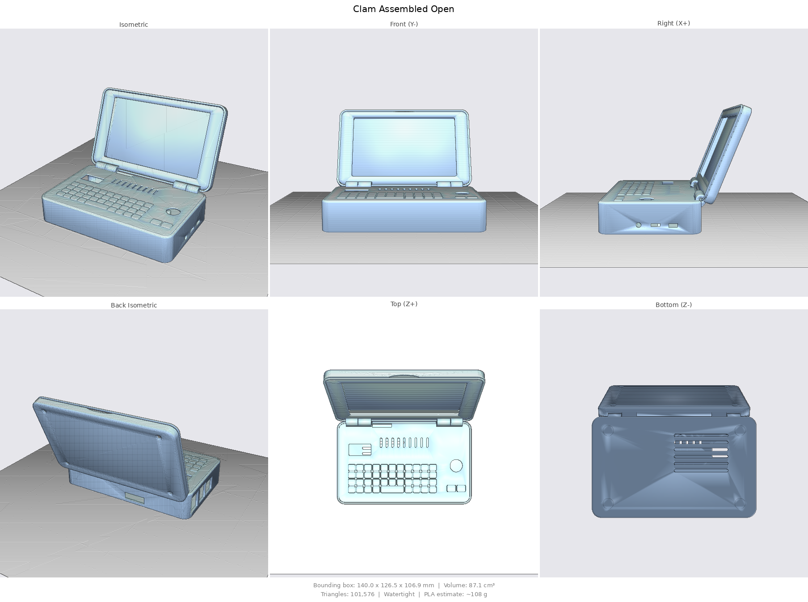

# Pi 5 Clamshell (concept, phase 1)

A pocket laptop around a Raspberry Pi 5: a 5" DSI touchscreen in a hinged lid, our own thumb
keyboard (RP2040) with a trackball, L/R buttons and a 0.96" OLED status screen, and a 2× 18650
battery that powers the Pi.

| | |
|---|---|
| Footprint | 140 × 86 mm |
| Thickness | base 27.2 mm, closed 36.8 mm |
| Battery | 2S 18650 stick pack (cells end to end) + BMS, ~25 Wh, about 2.5–3.5 h |
| Screen | 5" 800×480 DSI touch (e.g. Waveshare 5inch DSI LCD) — **check its outline** |
| Keyboard | 44 thumb keys + L/R on 5.2×5.2×1.5 mm SMD switches, one-piece TPU key mat |

## Layout
- **Base:** Pi 5 at the back under the keys (USB/Ethernet out the left wall, 2× micro-HDMI out
  the back between the hinges), battery along the front, power boards on the right.
- **Right wall:** USB-C charging, master switch (step-down enable), power button wired to the
  Pi 5 power-button pads.
- **Lid:** Waveshare 5" DSI LCD (121 × 76 mm) behind a 1.2 mm bezel, held by 4 M2.5 screws through the lid back into its corner standoffs (113 × 68 mm). The DSI flat cable passes through a slot between the hinges, above the Pi 5 display connector. Measure the screen thickness (`scr_t`) before printing.
- **Hinge:** two printed knuckle pairs on M3×30 axles with nylon washers for friction. The axis sits on the rear edge, level with the base top, so the lid opens freely (checked collision-free from 0° to 140°); 45° gussets under the barrels print without supports.

## Power
USB-C → 2S charger (IP2326 type) → 2S pack with BMS → master switch → 5 V 5.5 A step-down
(Pololu D36V50F5) → Pi 5 USB-C. Set `PSU_MAX_CURRENT=5000` in the Pi EEPROM so it allows full
USB current. The keyboard RP2040 measures the pack voltage for the OLED and a Linux battery
indicator. Charging while running works but slowly; a power-path charger on our own PCB is an
option for phase 2.

## Files
`clamshell.py` (CadQuery, all dimensions are parameters at the top) → `stl/`:

| Part | Print | Material |
|---|---|---|
| `clam_base.stl` | floor down | PETG |
| `clam_top_plate.stl` | top face down | PETG |
| `clam_keymat.stl` | caps down | TPU 95A |
| `clam_lid_back.stl` | outside face down | PETG |
| `clam_lid_bezel.stl` | front face down | PETG |

## Next
Phase 2: keyboard PCB in KiCad (RP2040, key matrix, OLED, trackball header, battery sense),
ready for JLCPCB. Phase 3: firmware and Linux integration.

## Phase 2 status
Keyboard PCB: see [`../keyboard-pcb`](../keyboard-pcb). Schematic and placement are done and
checked; routing is next. Change from phase 1: the keyboard talks to the Pi over the Pi 5's
internal UART connector (the Pi's USB ports face out through the case wall), and takes 5 V from
the step-down. The deck now has five M2 bosses that hold the keyboard PCB.
